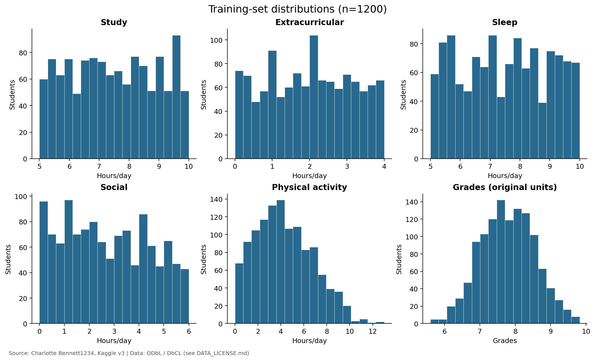
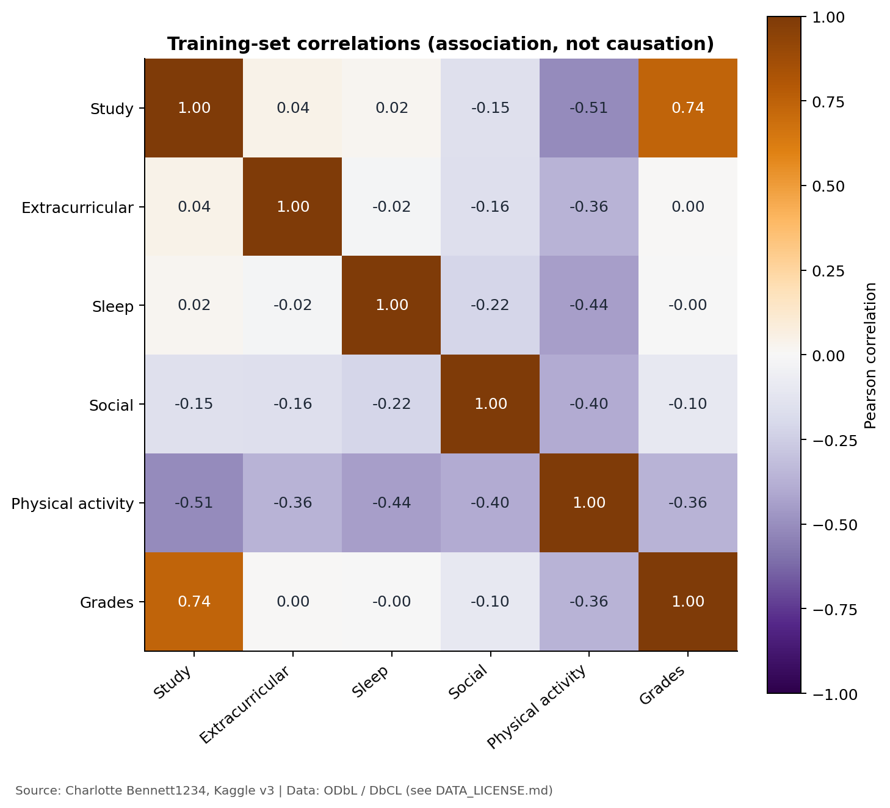
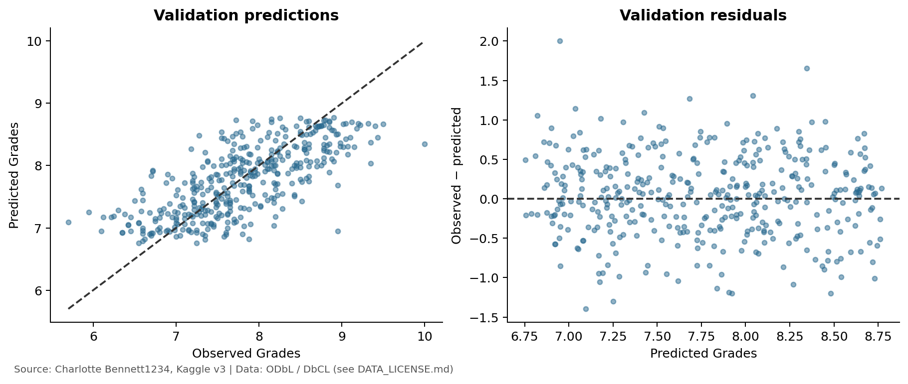

# GE2340 数据分析与基线结果

技术依据 | 2026 年 11 月 3 日 | 回归方法已与提交版 Phase 1 核对

本报告记录数据集、探索性分析、实验设置和基线结果，供团队撰写报告使用。连续成绩预测所需的数据准备已完成，分类目标见第 6 节。回归方法与提交的 Phase 1 方案一致。

## 1 数据集与数据质量

- 来源：*Lifestyle Factors and Their Impact on Students*，Charlotte Bennett1234，Kaggle 版本 3。原始文件包含 2,000 行、9 列。
- 目标变量 `Grades` 保留原始单位，在完整数据集中的取值范围为 5.60–10.00。
- 预测变量：`Study_Hours_Per_Day`、`Extracurricular_Hours_Per_Day`、`Sleep_Hours_Per_Day`、`Social_Hours_Per_Day` 和 `Physical_Activity_Hours_Per_Day`，均以每天的小时数计量。
- `Student_ID` 仅用于标识记录。按照 Phase 1 的五项输入方案，模型不使用 `Gender` 和 `Stress_Level`。

| 质量检查 | 结果 |
|---|---|
| 原始文件中的缺失单元格 | 0 |
| 完全重复的行 / 重复的学生 ID | 0 / 0 |
| 删除 / 填补的行数 | 0 / 0 |
| 保留的有效观测数 | 2,000 |
| 每日时长 | 五项时长之和均在浮点容差范围内等于 24 |

我们检查了数据结构、数值是否有限、ID 是否唯一，以及时长是否处于 0–24 小时范围内。全部观测均予以保留，无需填补。训练集中的四分位距（IQR）标记用于识别潜在异常值。

依据：[quality_audit.json](../outputs/quality_audit.json)；[student_lifestyle_dataset..csv](../data/raw/student_lifestyle_dataset..csv)；[run_pipeline.py](../src/run_pipeline.py)。

## 2 数据准备与描述统计

- 使用固定随机种子 2340，将 20% 的观测留作测试。在剩余的 80% 中，将 25% 分配给验证集。最终得到 1,200 条训练观测、400 条验证观测和 400 条测试观测。
- 探索性图表和相关性分析仅使用训练集。`StandardScaler` 在训练集预测变量上拟合，再将同一变换应用于验证集和测试集。`Grades` 未进行标准化。
- 共享数据文件保留全部五项预测变量。只有线性基线使用四项变量，并以体育活动作为参照活动。

| 训练集变量 | 均值 | 样本标准差 | 最小值 | 最大值 |
|---|---:|---:|---:|---:|
| 学习 | 7.494 | 1.442 | 5.000 | 10.000 |
| 课外活动 | 1.984 | 1.136 | 0.000 | 4.000 |
| 睡眠 | 7.496 | 1.459 | 5.000 | 10.000 |
| 社交 | 2.720 | 1.702 | 0.000 | 6.000 |
| 体育活动 | 4.306 | 2.475 | 0.000 | 13.000 |
| Grades | 7.777 | 0.763 | 5.600 | 9.820 |

训练样本量 n = 1,200。时长单位为小时/天，Grades 保留原始单位。样本标准差以 n−1 为分母。StandardScaler 使用总体标准差的计算约定，因此上表的标准差与其缩放参数不同。

**图 1.** 训练集分布，展示各变量的观测范围和分布形态。

## 3 探索性关系及解释

**图 2.** 训练集 Pearson 相关性，n = 1,200。图中已注明数据来源。

| 预测变量 | 与 Grades 的相关系数 |
|---|---:|
| 学习 | 0.7391 |
| 体育活动 | −0.3614 |
| 社交 | −0.1009 |
| 课外活动 | 0.0024 |
| 睡眠 | −0.0015 |

- 在所测量的预测变量中，学习时长与 Grades 的正向线性关联最强。睡眠和课外活动时长与 Grades 的边际相关系数接近零。
- 各项活动合计为 24 小时，因此增加某项活动时长就需要减少一项或多项其他活动的时长。学习与体育活动的相关系数为 −0.5115。

依据：[train_correlations.csv](../outputs/train_correlations.csv)。原始数据包中的[散点图](../outputs/figures/03_relationships_train.png)从另一角度展示了同一批训练观测。

## 4 线性回归与基线评估

- 均值基线对每条观测都预测为 7.777125，即 1,200 条训练观测的 Grades 均值。
- 我们使用 scikit-learn 的 `LinearRegression`，通过带截距的普通最小二乘法（OLS）拟合线性模型。平方误差目标与提交版 Phase 1 方案中的均方误差（MSE）目标一致。模型使用未经标准化的训练集时长，并以 Grades 的原始单位输出预测值。
- 五项时长之和为 24，其中心化训练矩阵的秩为 4。将体育活动设为参照可消除系数冗余；总时长约束仍保留了该变量的信息。

| 数据子集 | 模型 | MAE | RMSE | R² |
|---|---|---:|---:|---:|
| 训练集 | 线性回归 | 0.4067 | 0.5131 | 0.5474 |
| 训练集 | 均值基线 | 0.6234 | 0.7626 | 0.0000 |
| 验证集 | 线性回归 | 0.4104 | 0.5183 | 0.5147 |
| 验证集 | 均值基线 | 0.6049 | 0.7442 | -0.0005 |
| 测试集 | 线性回归 | 0.3725 | 0.4731 | 0.5403 |
| 测试集 | 均值基线 | 0.5659 | 0.6994 | -0.0044 |

MAE 表示平均绝对预测误差，RMSE 表示均方根误差。两者均以 Grades 的原始单位表示，数值越小，误差越小。R² 将模型的平方预测误差与始终预测为评估集自身均值时的平方误差进行比较。R² 越高越好，也可能为负值。

- 在测试集上，线性回归的 MAE 为 0.372452，均值基线为 0.565948，降幅约为 34.2%。测试集 R² 为 0.540324。
- 训练集和验证集的 MAE 分别为 0.406691 和 0.410385。模型在这两个数据集上的预测误差相近。

`Phase1_Proposal.pdf` 第 1 页明确采用均方误差，并通过令导数为零求得最佳拟合参数。此处使用的 OLS 方法遵循该目标。

## 5 验证集诊断与实验状态

**图 3.** 验证集诊断，n = 400。残差定义为 Grades 的观测值减去预测值。

- 数据集的原始采集方法，以及数据来自真实观测还是合成生成，尚未核实。
- OLS 模型和均值基线已在固定数据划分上完成评估。
- 第 6 节定义了分类目标。Softmax 的结果仍待完成，需提供分类准确率和 Macro-F1。神经网络实验为选做。

### 证据与来源引用

原始数据集：Charlotte Bennett1234。[Lifestyle Factors and Their Impact on Students](https://www.kaggle.com/datasets/charlottebennett1234/lifestyle-factors-and-their-impact-on-students)。Kaggle，版本 3。

数据集许可条款：[Open Database License 1.0](https://opendatacommons.org/licenses/odbl/1-0/) 和 [Database Contents License 1.0](https://opendatacommons.org/licenses/dbcl/1-0/)。图表和派生表格保留来源署名。

可复现依据：[metrics.csv](../outputs/metrics.csv)；[regression_model.json](../outputs/regression_model.json)；[train_descriptive_statistics.csv](../outputs/train_descriptive_statistics.csv)；[train_correlations.csv](../outputs/train_correlations.csv)；[split_manifest.csv](../outputs/processed/split_manifest.csv)；[preprocessor.json](../outputs/processed/preprocessor.json)；[run_pipeline.py](../src/run_pipeline.py)。数据包包含原始来源元数据和可执行的数据处理与实验流程。

### 项目状态

- 第 6 节中的等级分组已固定。
- 回归基线采用平方误差 OLS 目标，在固定的 24 小时约束下使用四项预测变量。
- Softmax 的结果仍需整合到团队报告中。若完成选做实验，再加入神经网络结果。

## 6 项目自定义分类目标

本项目根据训练集分布定义相对成绩等级。F 表示相对成绩最低的一组，不代表官方的不及格类别。

训练集的第 20、40、60 和 80 百分位数分别为 7.10、7.55、8.00 和 8.45。我们将这些固定边界原样应用于验证集和测试集。同分观测使用相同标签，因此各组数量可能不同。

| 等级 | Grades 区间 | 训练集 | 验证集 | 测试集 |
|---|---|---:|---:|---:|
| F | Grades < 7.10 | 238 | 69 | 59 |
| D | 7.10 ≤ Grades < 7.55 | 236 | 79 | 78 |
| C | 7.55 ≤ Grades < 8.00 | 234 | 99 | 104 |
| B | 8.00 ≤ Grades < 8.45 | 249 | 62 | 75 |
| A | Grades ≥ 8.45 | 243 | 91 | 84 |

上述区间定义了分类标签。

这些边界由训练数据计算得出。加入分类任务时，v1 的测试集回归结果已经查看过。

共享数据包包含数据划分、预处理参数和分类标签。

### 多数类基线

多数类基线始终预测为 B，即训练集中数量最多的类别（1,200 条记录中有 249 条）。该基线用于评估后续分类器的表现。

| 数据子集 | 准确率 | Macro-F1 | 平衡准确率 |
|---|---:|---:|---:|
| 训练集 | 20.75% | 0.06874 | 0.20 |
| 验证集 | 15.50% | 0.05368 | 0.20 |
| 测试集 | 18.75% | 0.06316 | 0.20 |

Macro-F1 对各类别赋予相同权重。平衡准确率是各类别召回率的平均值。依据为 v2 中的 [class_counts.csv](../outputs/class_counts.csv) 和 [classification_metrics.csv](../outputs/classification_metrics.csv)。
